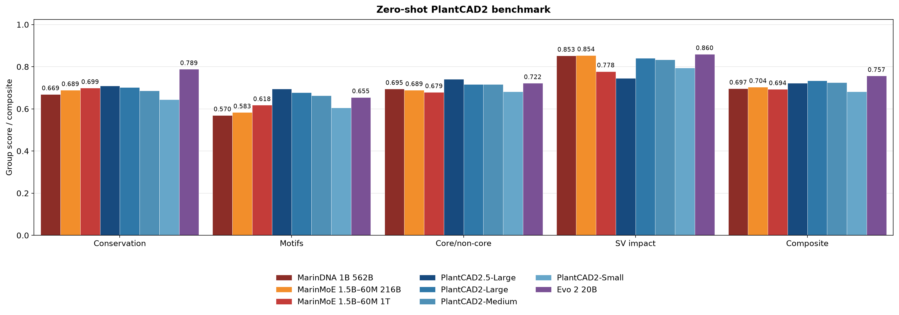
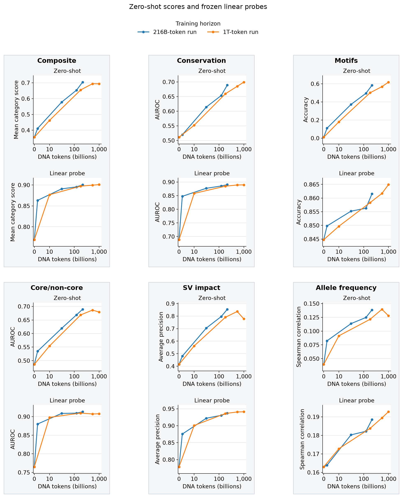
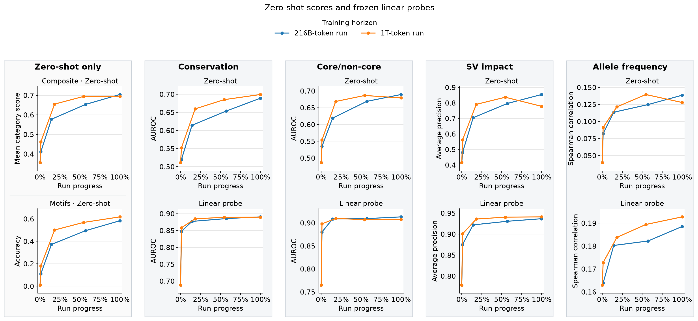
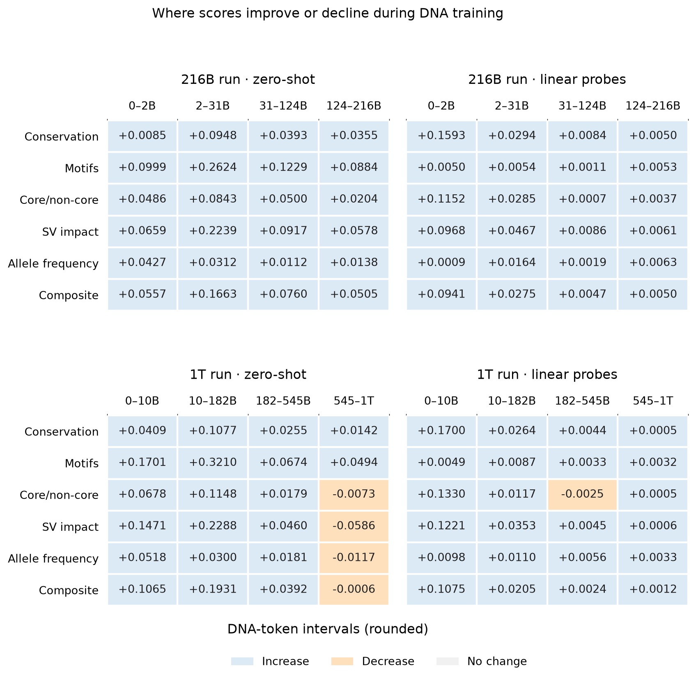

WIP

Final text-pretrained MarinMoE checkpoints versus dense MarinDNA and published baselines on the zero-shot PlantCAD2 benchmark.

  

These evaluations follow five checkpoints from each text-pretrained MarinMoE 1.5B–60M run (216B and 1T DNA tokens), including their shared starting model before DNA training.
Alongside the existing allele-frequency (AF) regression probe, frozen linear classifiers were added for conservation, motif recovery, core/non-core and structural-variant (SV) impact, with task-specific inputs described below.

  

Run-progress view, checkpoint changes, and probe setup

  

_Same scores, using recorded W&B `run_progress`: 100% is each run's final checkpoint, at different token totals.
Intermediate checkpoints are approximately matched in progress.
The checkpoint token axis is linear through 10B and logarithmic above it.
For both zero-shot and probes, Composite equally averages conservation, motifs, core/non-core and SV; AF is separate.
The motif score averages eight recovery tasks: start/stop codons and splice donor/acceptor sites in maize and tomato._

  

_Changes are in the original score units; colors show direction, not magnitude._

**What the probes see and predict**

All features use final-layer activations from the frozen model in forward (F) and reverse-complement (RC) passes.
Brackets below mean concatenation: keeping vectors side by side so the fitted head can weight them separately.

| Task | Inputs and frozen features | Outcome and fitted head |
| --- | --- | --- |
| Conservation | Withhold the target base. Encode the left flank forward and the right flank as RC; concatenate their last-token activations: `[F, RC]`. | Binary conservation label; L2 logistic regression. |
| Motifs | Withhold the entire 2–3-base motif; use the same two-flank `[F, RC]` features. | Complete motif sequence; L2 multinomial logistic regression, scored by whole-motif exact-match accuracy. |
| Core/non-core | Withhold the **entire target motif**, then use the same two-flank `[F, RC]` features. | Binary core/non-core label; L2 logistic regression. |
| SV impact | Encode the observed reference (REF) and deletion (ALT) sequences in both directions. Mean-pool tokens, average F/RC per allele, then concatenate `[REF, ALT−REF]`. | Original binary SV label; L2 logistic regression. |
| AF | Encode known REF/ALT alleles in both directions. At the variant token, concatenate `[REF_F, ALT_F−REF_F, REF_RC, ALT_RC−REF_RC]`. | Continuous, raw alternate-allele frequency; L2 ridge regression, scored by Spearman correlation. |

**Train/test separation**

- **Conservation, motifs, core/non-core and SV:** fixed whole-chromosome test holdouts, chosen without model scores; remove identical visible inputs, including RC equivalents, across the split. Select regularization with three-fold chromosome-grouped cross-validation on training chromosomes; motif heads use exact-match accuracy for selection.
- **AF:** reuse the existing approximately 70/30 split by **1 Mb genomic blocks**, balanced by consequence and within-consequence AF decile. Remove training variants within 8,192 bp of test variants to prevent overlapping windows: 65,565 train and 28,378 test. Select ridge regularization with five-fold block-grouped cross-validation inside training data.

Split memberships stay fixed across checkpoints; feature scaling and regularization selection use training folds only, and each checkpoint gets a newly fitted head.
Zero-shot and probe cohorts can differ, so their absolute score levels are not a paired comparison.

### Motif baselines

Controls and motif probes use **whole-motif exact-match accuracy on identical held-out examples**, averaged equally across eight tasks.
The constant predictor emits the most frequent training motif; shuffled-label heads fit permuted training labels, leaving test labels unchanged.
Shuffled columns show the final 216B and 1T checkpoints.
The **83.71%** baseline is directly comparable to probe scores; high accuracy alone does not establish context learning.
Zero-shot scores weight tasks equally but use a different cohort.

| Motif task | Constant prediction | Constant accuracy | Shuffled: 216B | Shuffled: 1T |
| --- | --- | ---: | ---: | ---: |
| Maize start codon | ATG | 97.28% | 97.28% | 97.28% |
| Maize stop codon | TGA | 46.35% | 43.52% | 44.18% |
| Maize splice donor | GT | 98.31% | 98.31% | 98.30% |
| Maize splice acceptor | AG | 99.82% | 99.82% | 99.79% |
| Tomato start codon | ATG | 96.72% | 96.72% | 96.72% |
| Tomato stop codon | TGA | 38.39% | 36.50% | 37.23% |
| Tomato splice donor | GT | 95.84% | 95.84% | 95.83% |
| Tomato splice acceptor | AG | 96.98% | 96.98% | 96.98% |
| **Equal-task mean** | | **83.71%** | **83.12%** | **83.29%** |

