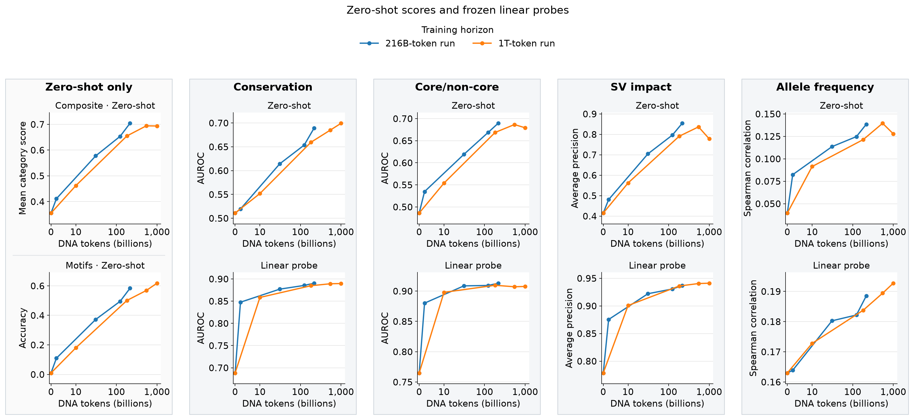
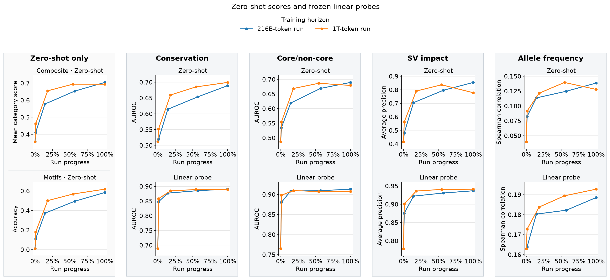
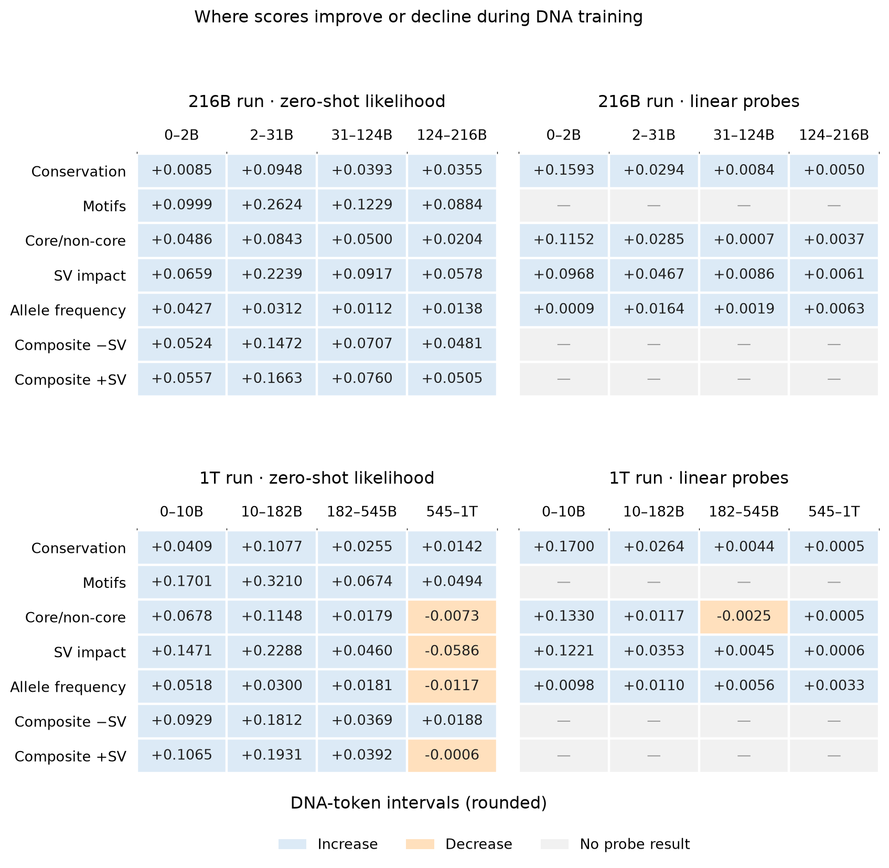

WIP

These evaluations follow five checkpoints from each text-pretrained MarinMoE 1.5B–60M run (216B and 1T DNA tokens), including their shared starting model before DNA training.
Alongside the existing allele-frequency (AF) regression probe, frozen linear classifiers were added for conservation, core/non-core and structural-variant (SV) impact, with task-specific inputs described below.

  

Run-progress view, checkpoint changes, and probe setup

  

_Same scores, using recorded W&B `run_progress`: 100% is each run's final checkpoint, at different token totals.
Intermediate checkpoints are approximately matched in progress.
The main figure instead uses a token axis that is linear through 10B and logarithmic above it.
Composite averages conservation, motifs, core/non-core and SV; AF is separate._

  

_Changes are in the original score units; colors show direction, not magnitude.
Motif probes were excluded, so matching probe composites are unavailable._

**What the probes see and predict**

All features use final-layer activations from the frozen model in forward (F) and reverse-complement (RC) passes.
Brackets below mean concatenation: keeping vectors side by side so the fitted head can weight them separately.

| Task | Inputs and frozen features | Outcome and fitted head |
| --- | --- | --- |
| Conservation | Withhold the target base. Encode the left flank forward and the right flank as RC; concatenate their last-token activations: `[F, RC]`. | Binary conservation label; L2 logistic regression. |
| Core/non-core | Withhold the **entire target motif**, then use the same two-flank `[F, RC]` features. | Binary core/non-core label; L2 logistic regression. |
| SV impact | Encode the observed reference (REF) and deletion (ALT) sequences in both directions. Mean-pool tokens, average F/RC per allele, then concatenate `[REF, ALT−REF]`. | Original binary SV label; L2 logistic regression. |
| AF | Encode known REF/ALT alleles in both directions. At the variant token, concatenate `[REF_F, ALT_F−REF_F, REF_RC, ALT_RC−REF_RC]`. | Continuous, raw alternate-allele frequency; L2 ridge regression, scored by Spearman correlation. |

**Train/test separation**

- **Conservation, core/non-core and SV:** fixed whole-chromosome test holdouts, chosen without model scores; remove identical visible inputs, including RC equivalents, across the split. Select regularization with three-fold chromosome-grouped cross-validation on training chromosomes.
- **AF:** reuse the existing approximately 70/30 split by **1 Mb genomic blocks**, balanced by consequence and within-consequence AF decile. Remove training variants within 8,192 bp of test variants to prevent overlapping windows: 65,565 train and 28,378 test. Select ridge regularization with five-fold block-grouped cross-validation inside training data.

Split memberships stay fixed across checkpoints; feature scaling and regularization selection use training folds only, and each checkpoint gets a newly fitted head.
Zero-shot and probe cohorts can differ, so their absolute score levels are not a paired comparison.

