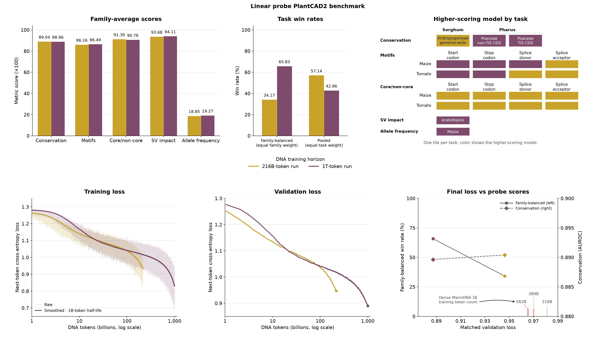
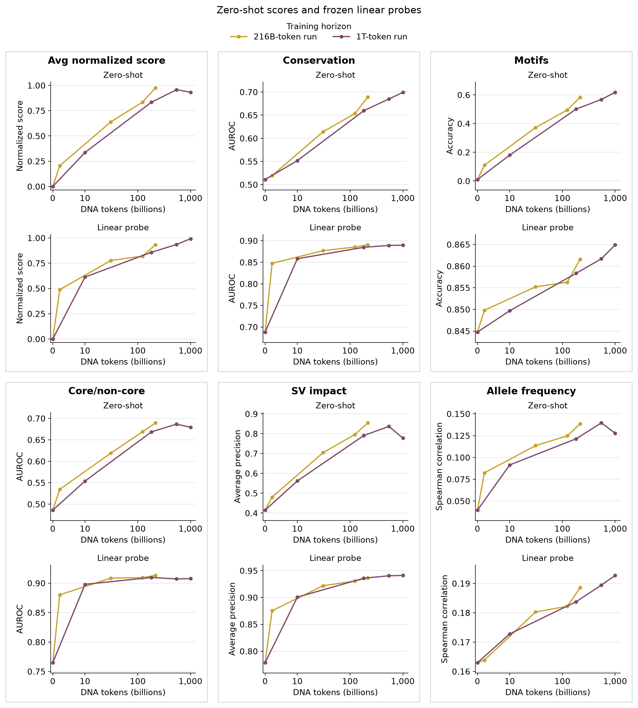
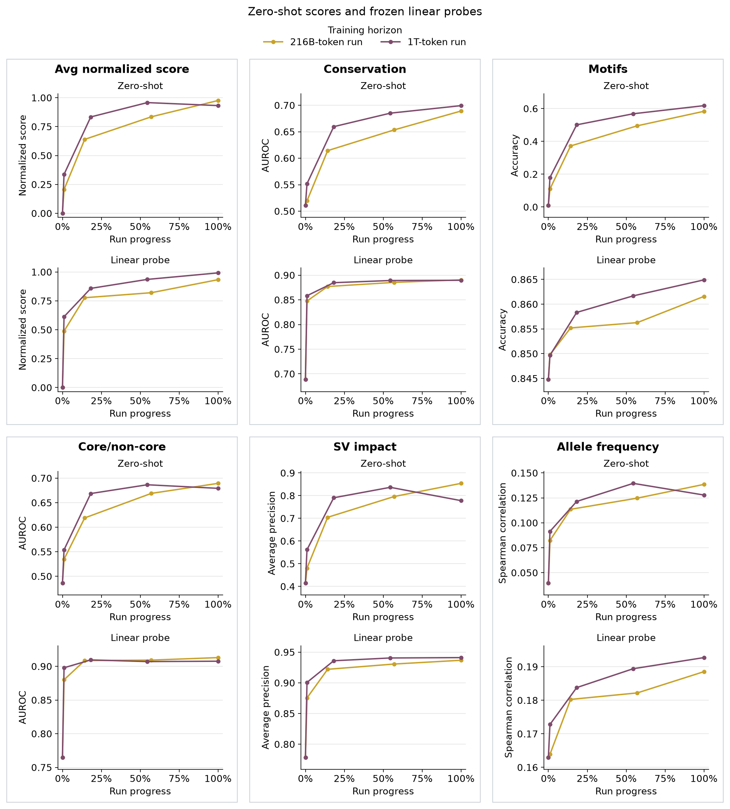
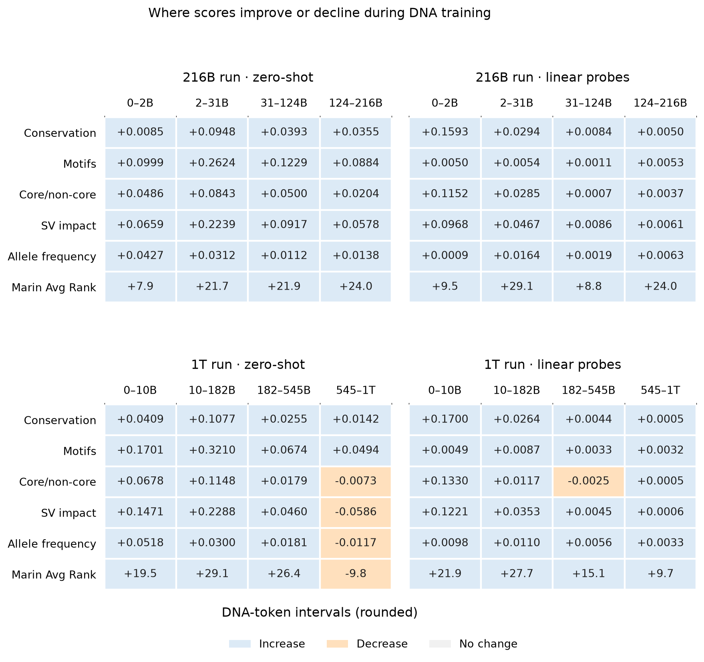

WIP

The text-pretrained 1T-token MarinMoE model has trained for ~46.3 DNA epochs, with ~1.5B total parameters, ~60M active per token, and a heuristic dense-equivalent size of √(1.5B × 60M) ≈ 300M parameters.[^dense-equivalent]
That 300M estimate is most comparable in size to **PlantCAD2-Medium** (311M parameters).

Overall, the 1T model greatly outperforms all other MarinDNA models (dense or sparse) on matched validation loss samples.  It also outperforms all other Marin models on tasks most directly related to next token prediction like conservation estimation and splicing/start/stop motif recognition.  It saturates or regresses on all other zero-shot tasks though, particularly SV prediction (similar to PlantCAD2.5).

However, monotonicity with scale is nearly perfect when using linear probes rather than zero-shot likelihoods.

  

_Task families retain native scores; Avg Rank has its own percentile axis and averages task percentiles within four equally weighted families. Higher is better; rank definitions are below._

  

Curves use W&B losses; the scatter uses the [matched 65,536-window sample](https://github.com/plantcad/plantcad2/pull/22#issuecomment-6604041302), with darker coral rugs for later dense checkpoints. The scatter now uses Avg Rank (left axis) and Conservation AUROC (right axis).

These evaluations follow five checkpoints from each text-pretrained MarinMoE 1.5B–60M run (216B and 1T DNA tokens), including their shared starting model before DNA training.
Alongside the existing allele-frequency (AF) regression probe, frozen linear classifiers were added for conservation, motif recovery, core/non-core and structural-variant (SV) impact, with task-specific inputs described below.

  

_Marin Avg Rank includes AF and uses nine fixed checkpoint references, separately for zero-shot and probes. All other panels retain native scores._

Run progress and score definitions

  

_Same scores, using recorded W&B `run_progress`: 100% is each run's final checkpoint, at different token totals.
Intermediate checkpoints are approximately matched in progress.
The checkpoint token axis is linear through 10B and logarithmic above it.
The motif score averages eight recovery tasks: start/stop codons and splice donor/acceptor sites in maize and tomato._

### Rank definitions

Only summaries **across task families** change. Conservation/core AUROC, motif accuracy, SV average precision and AF Spearman correlation retain their native values, including the existing mean across tasks within each family.

For each task, the percentile is `100 × (reference scores below the model + half the ties) / reference count`, using exact stored values. Average these task percentiles within each family, then average the families equally. Both rank summaries run from **0 to 100, higher is better**; they measure relative standing, not accuracy or effect size.

- **Avg Rank:** conservation, motifs, core/non-core and SV receive 25% each. Each task is ranked against the same **11 published baseline models**, frozen at the [archived leaderboard revision](https://huggingface.co/spaces/plantcad/plantcad2-zeroshot-leaderboard/blob/f3c4ddb1978b78ca56fed5d40378f0aa5f19ec29/data/results.csv). AF is unavailable for these baselines and is excluded.
- **Marin Avg Rank:** those four families plus AF receive 20% each. Each task is ranked against the **nine unique language-initialized MarinMoE checkpoints**, using separate zero-shot and probe reference scores. No published zero-shot values enter probe ranks.

The 11-model reference comprises PlantCAD (512 bp), PlantCAD2 Small/Medium/Large, PlantCAD2.5 Large, Evo 2 7B/20B, GPN, Carbon-3B and NTv3 100M/650M; it includes models not drawn in the overview.
The Marin reference contains the shared pre-DNA model once, four checkpoints from the 216B run (2.16B, 30.88B, 123.52B, 216.16B tokens), and four from the 1T run (10B, 181.82B, 545.46B, 1T tokens).

Reference membership stays fixed when adding future models. Finite reference sets make ranks coarse and can hide improvements within a rank interval; the native family panels retain that information. Compare rank values only within the same definition and readout. This follows the leaderboard's per-task percentile idea but gives families equal weight and freezes the reference sets.

Changes between checkpoints

  

_Family changes use native units; Marin Avg Rank changes use percentile points. Colors show direction, not magnitude._

Probe inputs and prediction targets

All features use final-layer activations from the frozen model in forward (F) and reverse-complement (RC) passes.
Brackets below mean concatenation: keeping vectors side by side so the fitted head can weight them separately.

| Task | Inputs and frozen features | Outcome and fitted head |
| --- | --- | --- |
| Conservation | Withhold the target base. Encode the left flank forward and the right flank as RC; concatenate their last-token activations: `[F, RC]`. | Binary conservation label; L2 logistic regression. |
| Motifs | Withhold the entire 2–3-base motif; use the same two-flank `[F, RC]` features. | Complete motif sequence; L2 multinomial logistic regression, scored by whole-motif exact-match accuracy. |
| Core/non-core | Withhold the **entire target motif**, then use the same two-flank `[F, RC]` features. | Binary core/non-core label; L2 logistic regression. |
| SV impact | Encode the observed reference (REF) and deletion (ALT) sequences in both directions. Mean-pool tokens, average F/RC per allele, then concatenate `[REF, ALT−REF]`. | Original binary SV label; L2 logistic regression. |
| AF | Encode known REF/ALT alleles in both directions. At the variant token, concatenate `[REF_F, ALT_F−REF_F, REF_RC, ALT_RC−REF_RC]`. | Continuous, raw alternate-allele frequency; L2 ridge regression, scored by Spearman correlation. |

Train/test splits and probe fitting

- **Conservation, motifs, core/non-core and SV:** fixed whole-chromosome test holdouts, chosen without model scores; remove identical visible inputs, including RC equivalents, across the split. Select regularization with three-fold chromosome-grouped cross-validation on training chromosomes; motif heads use exact-match accuracy for selection.
- **AF:** reuse the existing approximately 70/30 split by **1 Mb genomic blocks**, balanced by consequence and within-consequence AF decile. Remove training variants within 8,192 bp of test variants to prevent overlapping windows: 65,565 train and 28,378 test. Select ridge regularization with five-fold block-grouped cross-validation inside training data.

Split memberships stay fixed across checkpoints; feature scaling and regularization selection use training folds only, and each checkpoint gets a newly fitted head.
Zero-shot and probe cohorts can differ, so their absolute score levels are not a paired comparison.

Motif baselines and controls

Controls and motif probes use **whole-motif exact-match accuracy on identical held-out examples**, averaged equally across eight tasks.
The constant predictor emits the most frequent training motif; shuffled-label heads fit permuted training labels, leaving test labels unchanged.
Shuffled columns show the final 216B and 1T checkpoints.
The **83.71%** baseline is directly comparable to probe scores; high accuracy alone does not establish context learning.
Zero-shot scores weight tasks equally but use a different cohort.

| Motif task | Constant prediction | Constant accuracy | Shuffled: 216B | Shuffled: 1T |
| --- | --- | ---: | ---: | ---: |
| Maize start codon | ATG | 97.28% | 97.28% | 97.28% |
| Maize stop codon | TGA | 46.35% | 43.52% | 44.18% |
| Maize splice donor | GT | 98.31% | 98.31% | 98.30% |
| Maize splice acceptor | AG | 99.82% | 99.82% | 99.79% |
| Tomato start codon | ATG | 96.72% | 96.72% | 96.72% |
| Tomato stop codon | TGA | 38.39% | 36.50% | 37.23% |
| Tomato splice donor | GT | 95.84% | 95.84% | 95.83% |
| Tomato splice acceptor | AG | 96.98% | 96.98% | 96.98% |
| **Equal-task mean** | | **83.71%** | **83.12%** | **83.29%** |

[^dense-equivalent]: Geometric-mean heuristic using rounded parameter counts, as presented in [Marin’s Scaling Laws Explorer, MoE adjustment](https://marin.community/analysis/scaling-laws-analysis/); see [Clark et al. (2022), *Unified Scaling Laws for Routed Language Models*](https://proceedings.mlr.press/v162/clark22a.html) for effective-parameter scaling. This is an approximate size comparison, not a measured dense-model equivalence on DNA.
