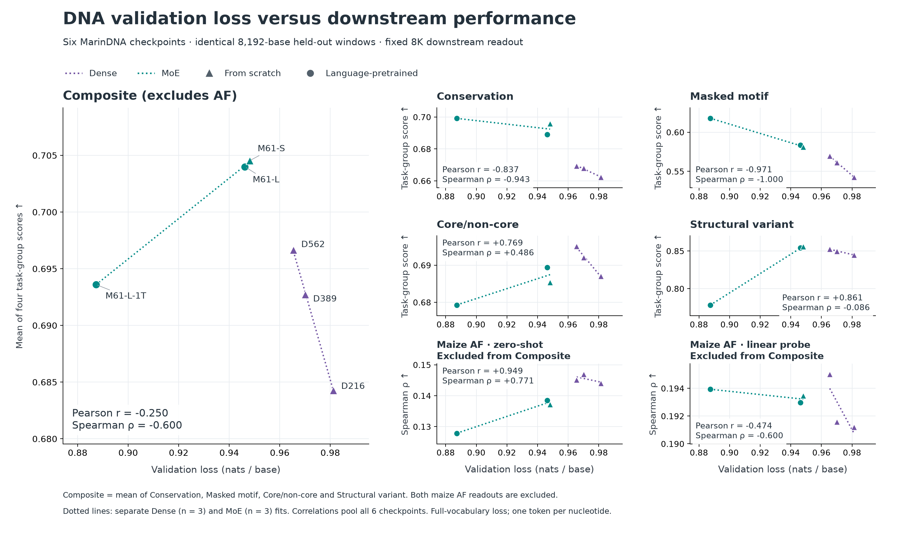
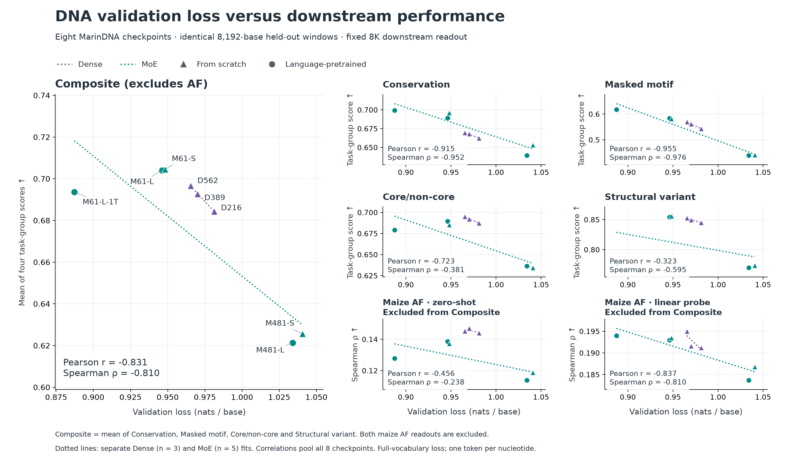

## DNA validation loss versus downstream evaluations

**The finished 1T model has the lowest validation loss, but a lower four-group Composite than its 0.22T counterpart.** Conservation and motif scores improve; structural-variant and core/non-core scores decline. Lower next-base loss does not guarantee better performance across these tasks.

On the identical validation sample, loss falls from **0.946216 to 0.887302**, while Composite changes from **0.7040 to 0.6936**. Across the 6 models below, Composite **Pearson r = -0.250; Spearman ρ = -0.600**. Maize allele frequency (AF) is separate and excluded from Composite.

Including the 481M-active MoEs (all 8 models)

Composite **Pearson r = -0.831; Spearman ρ = -0.810**.

| ID | MarinDNA model (total / active parameters) | Initialization | DNA tokens | Vocabulary | Validation loss | Training run |
| --- | --- | --- | ---: | ---: | ---: | --- |
| D216 | Dense 0.97B / 0.97B | Scratch | 216.16B | 7 | 0.981251 | [W&B](https://wandb.ai/plantcad/marin-dna/runs/exp472-plantcad2-angiosperm-lr0p0005-wd0p1-v2) |
| D389 | Dense 0.97B / 0.97B | Scratch | 389.09B | 7 | 0.970131 | [W&B](https://wandb.ai/plantcad/marin-dna/runs/exp472-plantcad2-angiosperm-lr0p0005-wd0p1-train-s01-v1) |
| D562 | Dense 0.97B / 0.97B | Scratch | 562.02B | 7 | 0.965427 | [W&B](https://wandb.ai/plantcad/marin-dna/runs/exp472-plantcad2-angiosperm-lr0p0005-wd0p1-train-s02-v1) |
| M481-L | MoE 11.53B / 481.3M | Language → DNA | 11.24B | 128,256 | 1.034050 | [W&B](https://wandb.ai/plantcad/marin-dna/runs/exp582-plantcad2-d1536-pretrained-lrm1-seed0-v1) |
| M481-S | MoE 11.14B / 481.3M | Scratch | 11.24B | 8 | 1.040699 | [W&B](https://wandb.ai/plantcad/marin-dna/runs/exp582-plantcad2-d1536-random-lrm2-seed0-v1) |
| M61-L | MoE 1.59B / 60.6M | Language → DNA | 216.16B | 128,256 | 0.946216 | [W&B](https://wandb.ai/eric-czech/marin/runs/exp586-plantcad2-d768-pretrained-lrm1-seed0-v1) |
| M61-S | MoE 1.39B / 60.6M | Scratch | 216.16B | 8 | 0.948175 | [W&B](https://wandb.ai/eric-czech/marin/runs/exp586-plantcad2-d768-scratch-lrm1-seed0-v1) |
| M61-L-1T | MoE 1.59B / 60.6M | Language → DNA | 1000.00B | 128,256 | 0.887302 | [W&B](https://wandb.ai/eric-czech/marin/runs/exp586-plantcad2-d768-pretrained-lrm1-seed0-1t-v1) |

MoE active counts exclude input/output embeddings; total counts include them. S = scratch; L = language-initialized; D = dense. Dense IDs indicate billions of DNA training tokens; M61-L and M61-S use 216.16B tokens, and M61-L-1T uses 1T.

Identical downstream metrics and readouts

All models use the historical **8K Natural** convention. Composite equally weights four task-group means: Conservation (3 AUROCs), Masked motif (8 whole-motif accuracies), Core/non-core (8 AUROCs), and Structural variant (1 AUPRC). The same 20 tasks and sample counts are used throughout. Natural reports the better forward/reverse-complement task metric where both exist; this direction selection uses evaluation labels, matching the historical dense results. SV retains its original causal scoring form. No PoE or context selection is substituted.

Maize AF zero-shot is Spearman correlation of the full causal-suffix allele log-likelihood ratio, averaged across strands, on **94,075 variants**. The frozen linear probe uses **8K target-position embeddings averaged across strands**, with the same genomic-block split and **28,378 held-out variants**. These are separate endpoints on different evaluation sets. The 1T point uses these exact readouts, rather than a different probe or its best-performing inference setting.

Matched validation loss and replay checks

Loss is measured on the same first **65,536 validation windows of 8,192 bp**, totaling **536,805,376 next-base targets**. The window data and order were verified against the original dense token cache. Inputs use one token per nucleotide, without packing, reverse complementation, or EOS. Cross-entropy is in nats over positions 2–8,192, includes N targets, and uses each model's full native vocabulary.

Dense runs already used this sample; their original losses are retained after a D216 replay check. Every MoE, including 1T, first reproduces its original 512-window validation loss, then scores this common sample with forward microbatches of 16 and zero dropped expert assignments. The 1T sample hash exactly matches the earlier analysis.

| ID | Original logged loss | Original-sample replay | Common-sample loss |
| --- | ---: | ---: | ---: |
| D216 | 0.98125064 | 0.98125068 | 0.98125064 |
| D389 | 0.97013146 | — | 0.97013146 |
| D562 | 0.96542716 | — | 0.96542716 |
| M481-L | 1.03529936 | 1.03530520 | 1.03405043 |
| M481-S | 1.04119466 | 1.04120194 | 1.04069893 |
| M61-L | 0.94750627 | 0.94750318 | 0.94621596 |
| M61-S | 0.94914071 | 0.94913985 | 0.94817529 |
| M61-L-1T | 0.88988553 | 0.88990800 | 0.88730214 |

Color distinguishes Dense from MoE; marker shape distinguishes scratch from language-pretrained initialization. Dotted regression lines are fitted separately to Dense and MoE checkpoints over their observed loss ranges; the displayed correlations pool all checkpoints in each figure. Loss uses each model's full native vocabulary; the A/C/G/T sensitivity check remains in the saved analysis.

Data and checkpoint provenance

All points are measured results from completed runs. Downstream evaluations and probe fits are reused from their saved outputs. Only the common-sample language-model losses were separately evaluated; no new model inference or probe fitting was needed for this update.

[Models, final checkpoints, and training-run bindings](models.json) · [Immutable validation samples](inputs.json) · [Loss artifacts and hashes](results-manifest.json) · [1T downstream provenance](downstream/m61-l-1t/provenance.json) · [Scores and correlations](analysis.json)

